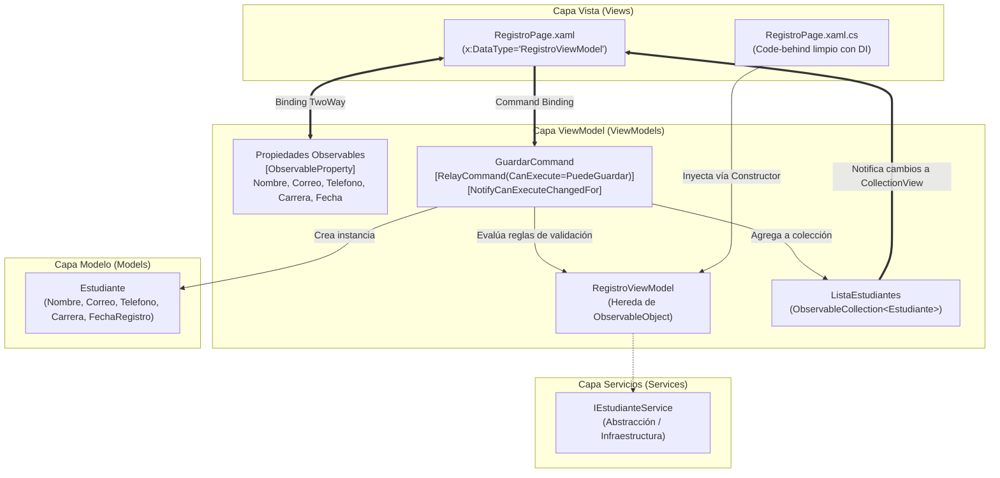

# 📱 Sistema de Registro de Estudiantes (.NET MAUI MVVM)

Proyecto académico desarrollado en **.NET MAUI** aplicando estrictamente el patrón arquitectónico **Model-View-ViewModel (MVVM)**, la librería oficial **CommunityToolkit.Mvvm**, enlace de datos compilado (*Compiled Bindings*) e Inyección de Dependencias (DI).

---

## 🏛️ 1. Arquitectura y Estructura del Proyecto

El proyecto está organizado siguiendo el principio de responsabilidad única (SRP) y una estricta separación de capas:

```text
RegistroEstudiantesMVVM/
├── Models/
│   └── Estudiante.cs            # Entidad pura del dominio académico
├── ViewModels/
│   └── RegistroViewModel.cs     # Lógica de presentación, validación reactiva y comandos
├── Views/
│   ├── RegistroPage.xaml        # Definición de la interfaz gráfica declarativa con Bindings compilados
│   └── RegistroPage.xaml.cs     # Code-behind desacoplado con Inyección de Dependencias
├── Services/
│   └── IEstudianteService.cs    # Contratos y abstracción para acceso a datos y servicios
├── MauiProgram.cs               # Configuración del contenedor IoC (Inversión de Control)
├── AppShell.xaml                # Enrutador de navegación principal
└── README.md
```

---

## 🔄 2. Diagrama del Flujo Arquitectónico (Mermaid.js)

El siguiente diagrama ilustra el flujo unidireccional y bidireccional de datos, comandos y notificaciones entre las capas del sistema:



---

## 🧩 3. Fundamentos Técnicos Implementados

### A. Separación Estricta de Capas
1. **Model (`Estudiante.cs`)**:
   - Define el modelo de datos sin dependencias de UI ni lógica de presentación.
   - Propiedades: `Nombre`, `Correo`, `Telefono`, `Carrera` y `FechaRegistro`.

2. **ViewModel (`RegistroViewModel.cs`)**:
   - Hereda de `ObservableObject` de `CommunityToolkit.Mvvm`.
   - Utiliza generadores de código fuente mediante los atributos `[ObservableProperty]`.
   - Mantiene una colección observable `ObservableCollection<Estudiante>` que notifica automáticamente a la UI ante inserciones.
   - Contiene la regla de negocio y validación `PuedeGuardar()`.

3. **View (`RegistroPage.xaml` & `RegistroPage.xaml.cs`)**:
   - Vista completamente declarativa en XAML.
   - Code-behind minimalista: no manipula controles por nombre ni contiene lógica de negocio; únicamente recibe el ViewModel por Inyección de Dependencias:
     ```csharp
     public RegistroPage(RegistroViewModel vm)
     {
         InitializeComponent();
         BindingContext = vm;
     }
     ```

4. **Services (`Services/`)**:
   - Define interfaces desacopladas (`IEstudianteService`) para facilitar la persistencia futura o pruebas unitarias (*mocking*).

---

### B. Bindings Compilados (`x:DataType`)
- Se configuró el atributo `x:DataType="viewmodels:RegistroViewModel"` a nivel de página y `x:DataType="models:Estudiante"` dentro del `ItemTemplate` de la `CollectionView`.
- **Ventajas frente al binding tradicional:**
  - **Detección temprana de errores:** Los errores tipográficos en las propiedades se validan en tiempo de compilación (`build-time`) y no en tiempo de ejecución (`runtime`).
  - **Alto rendimiento:** Elimina el uso intensivo de *Reflection*, mejorando drásticamente la velocidad de renderizado y el consumo de memoria en dispositivos móviles.

---

### C. Comandos y Validación Reactiva
- Implementación de `[RelayCommand(CanExecute = nameof(PuedeGuardar))]` para el método `Guardar()`.
- Se aplicó el atributo `[NotifyCanExecuteChangedFor(nameof(GuardarCommand))]` en cada una de las propiedades del formulario (`nombre`, `correo`, `telefono`, `carrera`, `fecha`).
- **Comportamiento reactivo:** Cada vez que el usuario escribe o modifica cualquier campo, el botón de "Guardar" reevalúa su estado de forma automática y se habilita únicamente cuando todos los campos son válidos:
  - Campos no vacíos ni con solo espacios en blanco.
  - Validación de estructura de correo electrónico con expresión regular (`regex`).
  - Longitud mínima de contacto telefónico.
- Al ejecutarse el guardado, la nueva entidad se incorpora a `ListaEstudiantes` y el formulario se restablece automáticamente.

---

### D. Inyección de Dependencias (IoC Container)
En `MauiProgram.cs`, se registraron la vista y el viewmodel en el contenedor de servicios de .NET:
```csharp
builder.Services.AddTransient<RegistroViewModel>();
builder.Services.AddTransient<RegistroPage>();
```
Y en `AppShell.xaml`, se estableció `RegistroPage` como la pantalla de inicio principal mediante `{DataTemplate views:RegistroPage}`.

---

## 🚀 4. Instrucciones de Compilación y Ejecución

### Prerrequisitos
- .NET 10 SDK (o .NET 8 / 9 SDK con carga de trabajo de .NET MAUI).
- Visual Studio 2022 / 2026 con soporte para `.NET Multi-platform App UI development`.

### Clonación y Ejecución Local
```bash
# 1. Clonar el repositorio
git clone https://github.com/Jonithinx/RegistroEstudiantesMVVM.git
cd RegistroEstudiantesMVVM

# 2. Restaurar dependencias
dotnet restore

# 3. Compilar el proyecto (Windows)
dotnet build -f net10.0-windows10.0.19041.0

# 4. Ejecutar la aplicación en Windows
dotnet run -f net10.0-windows10.0.19041.0
```

---

## 👨‍💻 Autor y Control Académico
- **Repositorio:** [github.com/Jonithinx/RegistroEstudiantesMVVM](https://github.com/Jonithinx/RegistroEstudiantesMVVM)
- **Patrón:** MVVM con CommunityToolkit.Mvvm
- **Plataforma:** .NET MAUI
